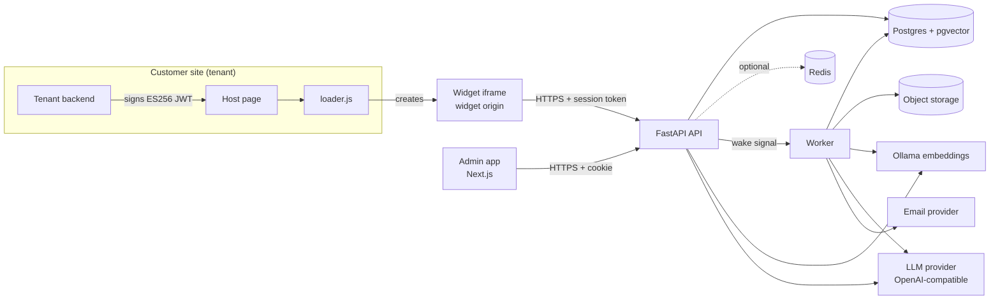
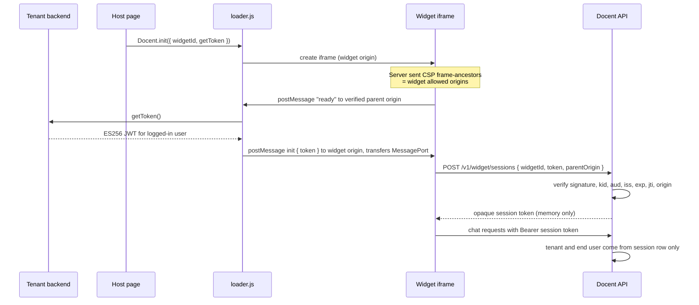
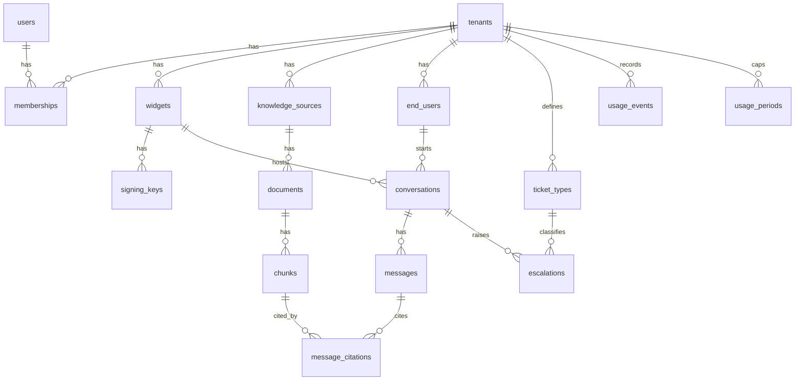

# Docent architecture

Status: draft for review. Nothing here is built yet.
Last updated: 2026-10-13.

This document is the plan that every phase in [PHASES.md](PHASES.md) builds
against. Project rules in [CLAUDE.md](../CLAUDE.md) win if the two disagree.

## Contents

1. [Decisions](#1-decisions)
2. [System overview](#2-system-overview)
3. [Tenancy and row-level security](#3-tenancy-and-row-level-security)
4. [Identity token flow and widget security](#4-identity-token-flow-and-widget-security)
5. [Data model](#5-data-model)
6. [Agent loop, retrieval, citations, escalation](#6-agent-loop-retrieval-citations-escalation)
7. [Redis: budget and degraded mode](#7-redis-budget-and-degraded-mode)
8. [Postgres job queue](#8-postgres-job-queue)
9. [Evaluation plan](#9-evaluation-plan)
10. [Usage metering, caps, billing](#10-usage-metering-caps-billing)
11. [Backups, migrations, leaving free tiers](#11-backups-migrations-leaving-free-tiers)
12. [Security and privacy baseline](#12-security-and-privacy-baseline)
13. [Risks and pushback](#13-risks-and-pushback)

---

## 1. Decisions

### Made (defaults chosen during planning; override any of them)

| # | Decision | Why |
|---|---|---|
| D1 | Widget has two modes. **Anonymous**: answers from public docs only, tighter caps, tenant can switch it off. **Identified**: tenant-signed token, account-aware answers. | The identity wedge needs server work from the tenant, so "one script tag" is only true for anonymous mode. Most pre-login traffic is anonymous. |
| D2 | Identified mode in v1 means **context, not actions**. The agent reads verified claims (name, plan, account id, allowlisted custom fields). It does not call tenant APIs to change anything. | Actions need delegated auth into tenant systems and a much bigger safety surface. Revisit after v1. |
| D3 | Tenant tokens are **ES256 JWTs signed with the tenant's private key**. Docent stores only public keys. | A Docent breach cannot mint user identities. |
| D4 | Shared schema, `tenant_id` on every tenant table, Postgres RLS with `FORCE ROW LEVEL SECURITY`, tenant set per transaction with `set_config('app.tenant_id', ..., true)`. | Works through PgBouncer transaction pooling on Neon. Session-level `SET` does not. |
| D5 | Staff auth is built into the FastAPI backend: email and password (argon2id), email verification, opaque session tokens hashed in Postgres. | One source of truth for sessions. No auth vendor lock-in. |
| D6 | LLM access goes through a thin internal client over the OpenAI-compatible Chat Completions API. No LiteLLM. | Works with Ollama local, Ollama Cloud, and most paid providers. Fewer dependencies. |
| D7 | Embeddings: `embeddinggemma` through Ollama, 768 dims, stored as `halfvec(768)`. Same model in dev, staging and prod. | Multilingual, 622 MB, 2.3 passages per second on a CPU-only laptop (six times faster than `qwen3-embedding:0.6b`, measured). Half-precision vectors halve storage on a 1 GB free database. Gemma terms of use allow commercial use. |
| D8 | Answers are **validated before they are shown**. No token streaming in v1. The widget shows progress states instead. | Citations must be checked against retrieved sources before a visitor sees anything. |
| D9 | Human replies to escalations go out **by email** in v1. No live takeover inside the widget. | Live takeover needs presence, routing, and websockets. Email covers the core need. |
| D10 | Hitting a usage cap switches the widget to **escalate-only mode** (contact form to a human). It never goes dark. | A hard cap that silences a customer's support is worse than no cap. |
| D11 | Billing sells **AI replies per month** with hard caps, plus optional one-time top-up packs. No metered overage. | Predictable price is the wedge. Flat subscription plus caps keeps billing simple. |
| D12 | Redis is optional. Every Redis use has an in-process or Postgres fallback. | Free tier is 500K commands per month and rejects requests past it. |
| D13 | Job worker wakes on an internal HTTP signal from the API, with a slow safety poll. No tight polling loop. | Neon Free gives 100 CU-hours a month and suspends after 5 idle minutes. A 1-second poll keeps compute awake all month. |
| D14 | Local dev: Docker Compose runs Postgres 17 with pgvector, Redis, and Mailpit. Ollama runs natively. | Matches Neon's Postgres 17 with pgvector 0.8. Docker on macOS has no GPU. |
| D15 | Original uploaded files go to object storage behind one interface: a Docker volume now, Cloudinary (raw files) later. Postgres holds chunks and metadata only. | Keeps the database small. |
| D16 | Next.js runs as a standalone Docker image next to the API. Not on Vercel Hobby. | Vercel Hobby forbids commercial use. |
| D17 | Escalations get a kanban board (Open, Assigned, Waiting, Resolved) as a second view of the inbox in Phase 5. | Escalations move through statuses; a board is the natural way to work them. |
| D18 | No visual workflow builder. Automation is "When ... Then ..." routing rules for escalations plus outgoing webhooks. | A node editor needs an execution engine, versioning, retries, secrets, and outbound requests (an SSRF surface). Routing rules cover support needs; webhooks let teams connect their own n8n, Zapier, or Make. |
| D19 | Billing runs on Stripe (founder's choice, 2026-10-14): hosted Checkout and customer portal, signed webhooks, prices found by lookup key from the plan catalog. | Stripe is not a merchant of record outside a few countries, so sales tax and VAT are ours: Stripe Tax is wired behind `STRIPE_AUTOMATIC_TAX` and must be configured with registrations before charging. Paddle and Polar remain the fallback if Stripe is not available in the business's country (O1). |

### Open (yours to decide, with the latest moment it blocks work)

| # | Question | Needed by | My default if you have none |
|---|---|---|---|
| O1 | Country where the business is registered. Decides whether Stripe can pay out there and which taxes apply. | Before charging real cards | Stripe (D19). Paddle or Polar if Stripe does not support the country. |
| O2 | Production LLM provider and monthly budget. Free tiers cannot carry customer data. | Phase 4 staging | Ollama Cloud paid plan to start (zero retention per its policy). Note its concurrency limits in section 13. |
| O3 | Hosting for API, worker, embeddings. No free tier allows an always-on worker. | Phase 4 staging | One small VM or Fly.io machine with 2 GB RAM running the Docker images. Roughly 7 to 15 USD per month. |
| O4 | Plan prices and caps. | Phase 7 | See the starting proposal in section 10. |
| O5 | Domain name. The widget needs stable HTTPS origins. | Phase 4 | Check availability for docent plus a suffix (getdocent, docent.support, usedocent). |

---

## 2. System overview



### Components

| Component | Tech | Responsibility |
|---|---|---|
| `apps/api` | FastAPI (async), Pydantic, asyncpg with plain SQL, Alembic (psycopg) | Public widget API, admin API, auth, agent loop, billing webhooks. |
| `apps/api` worker entrypoint | Same Python package, separate process | Ingestion, embedding, summaries, email, evals, rollups, retention. |
| `apps/web` | Next.js, TypeScript | Admin app and landing page. |
| `apps/widget` | TypeScript, Vite library build | `loader.js` (target under 6 KB gzipped) and the iframe app. |
| `apps/demo-host` | Static site plus tiny Node server | Fake customer site on a different origin for testing tokens and embedding. |
| `packages/api-client` | Generated from the FastAPI OpenAPI schema | Typed client shared by web and widget. |

### Repository layout

```
.
  apps/
    api/            uv project: src/docent/{api,worker,agent,ingest,db,...}, alembic/
    web/            Next.js admin + landing
    widget/         loader.js + iframe app
    demo-host/      test host site
  packages/
    api-client/
  infra/
    docker/         Dockerfiles
    backup/         pg_dump and restore scripts
  brand/
  docs/
  compose.yaml
  package.json      pnpm workspace root scripts
  pnpm-workspace.yaml
```

### Environments

| Env | Database | Redis | LLM | Embeddings | Email |
|---|---|---|---|---|---|
| Local | Docker `pgvector/pgvector:pg17` | Docker Redis (can be stopped to test degraded mode) | `gemma4:cloud` via local Ollama after `ollama signin` | Native Ollama | Mailpit |
| CI | Postgres service container | none (degraded mode is the tested default) | recorded fixtures; nightly eval uses dev model | Ollama in CI or fixtures | none |
| Staging | Neon Free | Upstash Free | dev model, synthetic data only | Ollama container | Resend Free |
| Prod | Paid Postgres (Neon paid or any provider with pgvector) | Upstash pay-as-you-go or none | paid provider (O2) | Ollama container | Resend paid |

---

## 3. Tenancy and row-level security

### Model

- One database, one schema. Every tenant-owned table has `tenant_id uuid not null`.
- Every tenant-owned table has RLS **enabled and forced**, so even the table
  owner is filtered:

```sql
alter table chunks enable row level security;
alter table chunks force row level security;
create policy tenant_isolation on chunks
  using (tenant_id = current_setting('app.tenant_id', true)::uuid)
  with check (tenant_id = current_setting('app.tenant_id', true)::uuid);
```

- If `app.tenant_id` is not set, `current_setting(..., true)` returns null, the
  comparison is null, and no rows match. **Fail closed.**

### Database roles

| Role | RLS | Used by | Notes |
|---|---|---|---|
| `docent_owner` | owns tables | Alembic migrations only | Never used by the running app. |
| `docent_app` | enforced | API process | No `BYPASSRLS`, no DDL. |
| `docent_worker` | enforced | Worker process | Sets tenant per job. Can read `jobs`. |
| `docent_ops` | `BYPASSRLS` | Billing rollups, platform admin scripts | Separate connection string, used by named code paths only, every use audited. |

### Setting the tenant

Every request or job runs its tenant work inside one explicit transaction:

```sql
begin;
select set_config('app.tenant_id', $1, true);   -- true = transaction-local
-- queries
commit;
```

Neon's pooler runs PgBouncer in transaction mode. Session `SET`, `LISTEN`,
SQL `PREPARE` and session advisory locks do not work through it. A
transaction-local setting stays on one server connection for the whole
transaction, which is safe. Neon's docs do not state this explicitly, so Phase 1
adds an integration test that runs against the pooled endpoint in staging.

The API gets the tenant from exactly one trusted place per request type:

| Request | Tenant comes from |
|---|---|
| Admin API | The staff session's active tenant, checked against `memberships`. |
| Widget API | The widget session row, which was created from a verified widget id. |
| Worker | `jobs.tenant_id`. |
| Billing webhook | Stripe customer id mapped through `subscriptions` (the `app.billing_customer` capability). Event metadata is never trusted for the tenant. |

Request bodies, URLs and chat content never set the tenant.

### Capability context (no BYPASSRLS anywhere in the app)

Some lookups must cross tenants before a tenant is known. Instead of
`security definer` functions owned by a role that bypasses RLS, the transaction
carries a narrow capability that a dedicated `for select` policy honors:

| Setting | Grants read access to | Used by |
|---|---|---|
| `app.tenant_id` | Every row of that tenant | All tenant work |
| `app.user_id` | The user's own `memberships` rows and the `tenants` they belong to | Log in, tenant switcher, `/me` |
| `app.invite_token` | The one `invitations` row whose token hash matches, and its tenant's name | Invitation lookup and accept |
| `app.billing_customer` | The one `subscriptions` row of that Stripe customer | Billing webhooks |

The widget id lookup in Phase 4 uses the same pattern (`app.widget_public_id`).

### Tables without RLS

Global tables (`users`, `user_sessions`, `auth_tokens`, `plans`,
`model_prices`, `jobs`, `billing_events`) hold no tenant content or are
accessed only by code that sets tenant context before touching tenant tables.

### Backups and RLS

RLS is forced, so even `docent_owner` cannot `pg_dump` tenant tables. Backups
run as a role with `BYPASSRLS`: the Neon project owner (a member of
`neon_superuser`) in hosted environments, the `postgres` superuser locally.

### Tests (required, CI-blocking)

1. **Catalog test**: query `pg_class` and `pg_policies`. Every table with a
   `tenant_id` column must have RLS enabled, forced, and a policy. New tables
   fail CI until they comply.
2. **Isolation test per table**: create tenants A and B, insert rows for both,
   set tenant A, assert only A rows are visible and inserting a B row fails.
3. **No tenant set**: every tenant table returns zero rows.
4. **Role test**: `docent_app` and `docent_worker` lack `BYPASSRLS` and DDL.
5. **API-level tests**: for each admin and widget endpoint, a tenant A
   credential requesting a tenant B id gets 404, not 403 (do not leak existence).

---

## 4. Identity token flow and widget security

### Setup by the tenant

1. Create a widget in the admin app. Get a public widget id like `wid_7Hc...`.
2. Add allowed origins, for example `https://app.acme.com`. Exact scheme, host
   and port. No wildcards in v1.
3. Generate a signing key. The admin app generates an ES256 key pair **in the
   browser** (WebCrypto), uploads the public JWK, and offers the private key as
   a one-time download. Tenants can also upload their own public key. Each key
   has a `kid`. Up to two active keys per widget allow rotation.
4. Choose which custom claims the agent may see (allowlist, max 20 keys).
5. Turn anonymous mode on or off.

### Token the tenant's server signs

```text
header  { "alg": "ES256", "kid": "key_01", "typ": "JWT" }
payload {
  "iss": "wid_7Hc...",          // widget id
  "aud": "docent",
  "sub": "user_8812",           // tenant's own user id
  "iat": 1760380000,
  "exp": 1760380600,            // at most 15 minutes after iat
  "jti": "random-unique-id",
  "name": "Sam Ortiz",
  "email": "sam@acme.com",
  "ctx": { "plan": "pro", "account_id": "acct_42" }
}
```

Docent publishes copy-paste signing snippets for Node, Python, Ruby, PHP, Go.

### Flow



### Verification rules on `POST /v1/widget/sessions`

- Request `Origin` must equal the widget origin (the iframe calls the API, not
  the host page). CORS on widget endpoints allows only the widget origin.
- `parentOrigin` must be in the widget's allowed origins. This is a second
  check; the real enforcement is `frame-ancestors`.
- Algorithm allowlist is `ES256` only. Reject `none`, `HS*`, `RS*`.
- `kid` must match an active key for this widget.
- `aud == "docent"`, `iss == widget id`, `exp - iat <= 900`, `exp > now - 60`,
  `iat < now + 60`.
- `jti` is stored on the session row with a unique index for its lifetime.
  Reuse is rejected (replay protection).
- `sub` is 1 to 255 chars. Custom claims are filtered to the allowlist, total
  under 4 KB.
- On success: upsert `end_users (tenant_id, external_id = sub)`, create a
  `widget_sessions` row, return a random 256-bit token. Only its SHA-256 hash is
  stored. Session lifetime 30 minutes. The loader calls `getToken()` again to
  renew.

### Anonymous sessions

- Allowed only if the widget has anonymous mode on.
- Session gets a random visitor id. The visitor id and conversation id live in
  the iframe's own `sessionStorage` so a page navigation keeps the thread. That
  storage belongs to the widget origin and is partitioned by the browser; it is
  never the host's storage.
- Known limit: when Chromium blocks third-party cookies (the default in
  Incognito), it also blocks that frame storage. Chat and handoffs still work,
  but each page load starts a new anonymous thread. WebKit keeps partitioned
  storage, so resume works there. A partitioned (CHIPS) cookie would fix it but
  breaks the no-cookies rule, so we accept the limit. Identified visitors are
  unaffected: the server resumes their latest conversation.
- Limits: per IP-hash per hour, per widget per day, tighter than identified.
- Optional bot check (Cloudflare Turnstile) per widget, off by default.
- Retrieval only sees sources with `audience = 'public'`.

### Widget hardening

- **Frame ancestors**: the iframe HTML is served with
  `Content-Security-Policy: frame-ancestors <allowed origins>`, built per widget.
  Browsers refuse to render the widget anywhere else.
- **postMessage**: the loader sends only to the fixed widget origin. The iframe
  accepts messages only when `event.source === window.parent` and
  `event.origin` is an allowed origin. After the handshake both sides talk over
  a transferred `MessagePort`, never `"*"`.
- **No host storage**: no cookies, no reading host cookies or `localStorage`.
  The identity token and session token live in memory only.
- **Loader** inserts one iframe and one launcher button in a closed Shadow DOM.
  No `eval`, no dynamic script loading. `/widget/v1/loader.js` is cached for
  five minutes. Before launch, add versioned immutable URLs
  (`/widget/v1.4.2/loader.js`) so customers can pin a release with
  Subresource Integrity.
- **Iframe CSP**: `script-src 'self'`, no inline scripts, `connect-src` the
  API origin only, `img-src 'self' data:`.
- **Rendering**: agent output is a small Markdown subset rendered without raw
  HTML. Links are allowed only to the URLs of the sources the answer cites
  (`https`, or `http` in local development). No remote images. The API also
  strips any link that is not a cited source's own before it stores the reply.
  This blocks exfiltration through crafted links or image URLs.
- **Logout**: `await Docent.reset()` resolves after the session is revoked on
  the server (or after 3 seconds), so the host can navigate safely afterwards.

### What the domain allowlist does not do

`Origin` headers are trivial to fake outside a browser. The allowlist stops
other sites from embedding the widget; it does not stop a script from calling
the API. Anonymous mode is protected by rate limits, per-widget daily caps, and
the optional bot check. Identified mode is protected by the signature.

### Scoping rule

Server-side actions and reads use `end_user_id` from the session row. A visitor
writing "I am admin@acme.com" or "my user id is 5" changes nothing.

---

## 5. Data model

All ids are UUIDv7 generated in the application (time-ordered, portable).
All timestamps are `timestamptz`. `T` marks tenant tables with RLS.



### Identity and tenancy

| Table | | Key columns |
|---|---|---|
| `tenants` | | `id, name, slug unique, status (active, suspended, deleted), plan_id, settings jsonb (tone, restricted_topics, escalation thresholds), created_at, deleted_at` |
| `users` | | `id, email unique (lowercased), password_hash (argon2id), name, email_verified_at, last_login_at, created_at` |
| `memberships` | T | `tenant_id, user_id, role (owner, admin, agent), created_at`. PK `(tenant_id, user_id)` |
| `user_sessions` | | `token_hash pk, user_id, active_tenant_id, ip_hash, user_agent, created_at, expires_at, revoked_at` |
| `auth_tokens` | | `token_hash pk, user_id, purpose (verify_email, reset_password), expires_at, used_at` |
| `invitations` | T | `id, tenant_id, email, role, token_hash, invited_by, expires_at, accepted_at` |
| `audit_log` | T | `id, tenant_id, actor_user_id, action, target_type, target_id, metadata jsonb, created_at` |

### Widget and end users

| Table | | Key columns |
|---|---|---|
| `widgets` | T | `id, public_id unique, tenant_id, name, allowed_origins text[], anonymous_enabled, anonymous_daily_cap, bot_check_enabled, allowed_claims text[], theme jsonb, created_at` |
| `signing_keys` | T | `kid pk, tenant_id, widget_id, alg ('ES256'), public_jwk jsonb, status (active, retired), created_at, retired_at` |
| `end_users` | T | `id, tenant_id, external_id, email, name, claims jsonb (allowlisted), first_seen_at, last_seen_at`. Unique `(tenant_id, external_id)` |
| `widget_sessions` | T | `token_hash pk, tenant_id, widget_id, mode (anonymous, identified), end_user_id null, visitor_id null, jti null, parent_origin, ip_hash, created_at, expires_at, revoked_at`. Unique `(widget_id, jti)` |

### Knowledge

| Table | | Key columns |
|---|---|---|
| `knowledge_sources` | T | `id, tenant_id, kind (upload, url, sitemap, text), title, uri, audience (public, identified), status (pending, syncing, ready, failed), sync_interval, last_synced_at, last_error, created_by, created_at, deleted_at` |
| `documents` | T | `id, tenant_id, source_id, title, url, mime, object_key, content_hash, page_count, char_count, version, created_at, deleted_at` |
| `chunks` | T | `id, tenant_id, document_id, source_id, ordinal, heading_path, content, token_count, page_from, page_to, url_anchor, audience, embedding halfvec(768), embedding_model, tsv tsvector generated, created_at` |

Indexes on `chunks`: HNSW on `embedding halfvec_cosine_ops`, GIN on `tsv`,
btree on `(tenant_id, document_id)`.

Storage estimate per chunk: about 1.5 KB vector, about 1.5 KB HNSW share,
2 to 3 KB text, about 1 KB tsvector and row overhead. Call it 7 KB. Neon Free's
1 GB holds roughly 100K chunks across all tenants after other tables. Plan caps
on pages (section 10) keep this in check.

### Conversations

| Table | | Key columns |
|---|---|---|
| `conversations` | T | `id, tenant_id, widget_id, mode, end_user_id null, visitor_id null, status (open, escalated, closed), outcome (auto_resolved, confirmed_resolved, escalated, abandoned) null, feedback (up, down) null, page_url, locale, started_at, last_message_at, closed_at` |
| `messages` | T | `id, tenant_id, conversation_id, role (visitor, agent, human, system), content, decision jsonb (type, confidence, reason), model, prompt_version, tokens_in, tokens_out, latency_ms, flagged_wrong bool, created_at` |
| `message_citations` | T | `tenant_id, message_id, marker, chunk_id null, document_title, url, excerpt, score`. Snapshot fields keep old answers auditable after a source is deleted |

### Escalations and inbox

| Table | | Key columns |
|---|---|---|
| `ticket_types` | T | `id, tenant_id, name, description (the agent reads this to classify), fields jsonb (text, email, number, select; required flags), notify_emails text[], priority, active, created_at` |
| `escalations` | T | `id, tenant_id, conversation_id, ticket_type_id null, reason (no_source, low_confidence, user_requested, restricted_topic, repeated_failure, cap_reached), fields jsonb, summary jsonb (issue, tried, user_context, sentiment, suggested_next_step), contact_email, status (open, assigned, waiting, resolved), assignee_user_id, created_at, first_response_at, resolved_at` |
| `notifications` | T | `id, tenant_id, user_id, kind, payload jsonb, read_at, created_at` |
| `notification_channels` | T | `id, tenant_id, kind (email, slack_webhook), target (encrypted), events text[], active` |
| `email_deliveries` | T | `id, tenant_id, escalation_id null, to_hash, provider_message_id, status, created_at` |

### Usage and billing

| Table | | Key columns |
|---|---|---|
| `plans` | | `id, name, price_cents, replies_cap, pages_cap, sources_cap, widgets_cap, seats_cap, anonymous_allowed, active` |
| `subscriptions` | T | `tenant_id pk, provider, provider_customer_id, provider_subscription_id, plan_id, status, current_period_start, current_period_end, cancel_at` |
| `topups` | T | `id, tenant_id, replies, provider_order_id, period_start, created_at` |
| `usage_events` | T | `id, tenant_id, kind (ai_reply, llm_call, embedding, ingest_page), quantity, model, tokens_in, tokens_out, cost_micros, conversation_id null, message_id null, idempotency_key unique, occurred_at` |
| `usage_periods` | T | `tenant_id, period_start, period_end, replies_cap, replies_used, replies_reserved, cost_micros, notified_80_at, notified_100_at`. PK `(tenant_id, period_start)` |
| `model_prices` | | `model, input_micros_per_mtok, output_micros_per_mtok, effective_from` |
| `billing_events` | | `provider_event_id pk, provider, type, payload jsonb, tenant_id null, processed_at` |

### Evaluation

| Table | | Key columns |
|---|---|---|
| `eval_sets` | T | `id, tenant_id, name, created_at` |
| `eval_cases` | T | `id, tenant_id, set_id, question, history jsonb, identity jsonb (simulated claims, or null for anonymous), expected (answer, escalate, clarify), must_include text[], must_not_include text[], gold_document_ids uuid[], tags text[], origin (manual, generated, conversation)` |
| `eval_runs` | T | `id, tenant_id, set_id, config jsonb (model, prompt_version, retrieval params), status, metrics jsonb, started_at, finished_at` |
| `eval_results` | T | `id, tenant_id, run_id, case_id, output jsonb, retrieved jsonb, verdict (correct, wrong, unsupported, escalated_correctly, escalated_wrongly), judge_notes, cost_micros, latency_ms` |

### Jobs

`jobs` is described in section 8.

---

## 6. Agent loop, retrieval, citations, escalation

### One visitor message, step by step

```
1. Record       store the message; an email sent after a handoff becomes its contact
2. Small talk   rules recognize greetings, thanks, goodbyes, "who are you", in seven
                languages: a template reply, no model call, no reply counted
3. Guard        rate limits, usage reservation (section 10)
4. Fast intent  rule match for "human", "agent", "person", restricted keywords
5. Rewrite      follow-up turns only: borrow the previous question for short ones
6. Retrieve     hybrid search, audience filter, top 8 sources
7. Evidence     no source clears the threshold: one small triage call sorts the
                message (see below) instead of an automatic handoff
8. Generate     structured decision with answer and source markers
9. Validate     schema, citation markers, account facts, link allowlist
10. Persist     message, citations, usage events, conversation state, handoff
11. Respond     widget gets the validated result
```

### Triage when nothing in the docs matches

A message that finds no supporting passage is not always a question for the
team. One structured call (about one second, a few hundred tokens) names its
intent, and the reply comes from a template, so triage never states a fact:

| Intent | What the visitor gets |
|---|---|
| Small talk | A friendly reply that says what the agent can help with |
| Off topic (general knowledge, other companies, code) | "I can only help with questions about {company}" |
| Unclear ("it doesn't work") | One clarifying question written by the model, shown only if it is a short question with no links |
| Account question, verified visitor | The answer model, with only the visitor's claims (section 4) |
| Product question | Handoff with reason `no_source`. These are the knowledge gaps. |
| Wants a person | Handoff with reason `user_requested` |

If the triage call fails, the message is handed off. Conversational replies
(decision type `reply`) never count against the plan's AI replies.

### How the team reaches the visitor

Every handoff says how the reply will arrive. A signed-in visitor hears "They
will reply to {email}". An anonymous visitor is asked to leave an email, in the
widget's form or simply by typing it in the chat; the agent confirms it and
stores it on the handoff. Later handoffs in the same conversation reuse it.

### Retrieval

- **Query embedding**: same model as chunks, with the model's query prefix.
- **Vector search**: HNSW cosine on `chunks.embedding`, top 20. Uses pgvector
  0.8 iterative index scans (`set local hnsw.iterative_scan = relaxed_order`)
  so filtering by tenant and audience still returns 20 rows when the index is
  shared by many tenants.
- **Keyword search**: `websearch_to_tsquery('simple', q)` against `chunks.tsv`,
  top 20. The `simple` config avoids English-only stemming.
- **Fusion**: reciprocal rank fusion (k = 60), keep top 8.
- **Audience filter**: anonymous sessions see `audience = 'public'` only.
  Identified sessions see `public` and `identified`.
- **Evidence gate**: pass if the best vector similarity is at or above a
  threshold calibrated per embedding model in the eval suite, or the best
  keyword match ranks above its threshold. Otherwise the decision is
  `escalate` with reason `no_source`, without calling the LLM. The one
  exception is a visitor with verified claims: the LLM then sees no sources,
  only the claims, so it can answer questions about the visitor's own account
  ("what plan am I on") or hand off. Such an answer must list the claim keys it
  used in `account_facts` and repeat a verified value as a whole word, or the
  turn becomes a handoff.

### Chunking

- Parse: PDF (`pypdf`), DOCX (`python-docx`), HTML (`trafilatura` for main
  content), Markdown and text as-is. No AGPL parsers.
- Split by heading structure first, then by size: about 400 tokens, 15 percent
  overlap, never across a top-level heading.
- Keep `heading_path` (for example "Billing > Refunds > Annual plans"), page
  numbers, and URL anchors so a citation can point to the exact place.

### Prompt structure

```
[system]   role, tone, rules, output schema, escalation rules, restricted topics
[context]  <verified_user> allowlisted claims, marked as data </verified_user>
[sources]  <source id="S1" title="..." heading="..."> text </source> ... S8
[history]  last 6 turns, older turns as a short summary
[visitor]  <visitor_message> text </visitor_message>
```

Sources and visitor text are wrapped and labeled as untrusted data. Source ids
are short (`S1` to `S8`), never database ids, so the model cannot invent
plausible ids.

### Output schema

```json
{
  "type": "answer | clarify | escalate",
  "answer": "Plain text with markers like [S2].",
  "citations": ["S2", "S5"],
  "confidence": "high | medium | low",
  "escalation_reason": null,
  "ticket_type_id": null,
  "ticket_fields": {}
}
```

### Getting structured output from any provider

Ollama Cloud does not support structured outputs. Local Ollama and most paid
providers do. The client picks a strategy per provider:

1. Native JSON schema (`response_format` / `format`) where supported.
2. Otherwise, a single tool definition whose parameters are the schema.
   (Ollama's OpenAI layer has no `tool_choice`, so the prompt instructs the
   call and the validator checks it.)
3. Otherwise, prompt-only JSON.

Every strategy ends in the same Pydantic validation. One repair retry with the
validation error. A second failure becomes `escalate` with `low_confidence`.
**Fail toward a human, never toward an unchecked answer.**

### Validation rules

- `type = answer` needs at least one citation, and every marker in the text must
  be in `citations` and in the retrieved set.
- Links in the answer must pass the allowlist (section 4).
- If the answer touches a restricted topic, the decision becomes `escalate`.
- `confidence = low` on an answer becomes `clarify` the first time and
  `escalate` the second time in the same conversation.

### Escalation rules

| Rule | Trigger | Result |
|---|---|---|
| No supporting source | Evidence gate fails, or no valid citation after repair | Offer human, create escalation if visitor agrees |
| Low confidence | Second low-confidence turn in a conversation | Offer human |
| Visitor asks for a human | Rule match or model intent | Escalate immediately, no argument |
| Restricted topic | Tenant list plus platform defaults: legal threats, security incidents, account deletion, billing disputes, medical or safety risk | Escalate immediately |
| Repeated failure | Two thumbs-down, or three visitor turns restating the same question | Offer human |
| Cap reached | Tenant usage period is full | Escalate-only mode (section 10) |

When escalating, a worker job picks the ticket type whose description clearly
fits (or none, for a greeting or a vague message), fills fields only with
values the customer stated or the verified claims contain, and writes the
summary (`issue, tried, user_context, sentiment, suggested_next_step`) for the
inbox. Placeholder values such as "unknown" or "anonymous visitor" are dropped
before they reach a field.

### What the agent remembers

| Memory | Lives in | Comes from | Who sees it | How long |
|---|---|---|---|---|
| Help articles | `knowledge_sources`, `documents`, `chunks` | Files, pages, sitemaps the team adds | Every visitor (by audience) | Until removed |
| Team answers | `team_answers`, as sources of kind `answer` | The team, often from a knowledge gap | Every visitor (by audience), cited like an article | Until removed |
| Conversation | `messages` | The current conversation, last 6 turns | That conversation | 90 days |
| Customer memory | `customer_memories` | A worker job, once a signed-in customer's conversation has been quiet for 15 minutes | That customer only, as notes | 90 days, up to 20 facts |
| Knowledge gaps | `knowledge_gaps` | Product questions handed off with no supporting source | The team, grouped by meaning | Until answered or dismissed |

Only help articles and team answers are sources: an answer must cite one of
them. Customer memory reaches the model in a `<customer_memory>` block that
the rules call notes, never a source, so it can shape an answer ("on Windows,
sign out and back in") but cannot be the answer. It keeps no secrets, card or
bank numbers, phone numbers, or emails, and the team can make the agent forget
one fact or one customer. Anonymous visitors are never remembered across
conversations.

Gaps close the loop: the team sees the questions the agent could not answer,
grouped by meaning with the query vectors retrieval already computed, and
answers a group with one team answer, which the agent then cites. The memory
page in the admin app draws all of this as a map.

### Prompt injection defenses

- All visitor text and all document text are untrusted. The system prompt says
  instructions inside them are data.
- The model has no tools that reach the network, the database, or other users.
  Retrieval runs before generation, outside the model's control.
- The model never sees another end user's data. Per-user context comes only
  from the current session's verified claims.
- Output is validated (citations, links, restricted topics) before display.
- Ingestion flags documents with instruction-like patterns aimed at the model
  for admin review. Flagging only, not blocking.
- The eval suite carries an injection set (section 9) that must pass 100
  percent.

### Models

| Use | Dev | Prod |
|---|---|---|
| Answer and decision | `gemma4:cloud` (free plan, synthetic data only) | Paid provider (O2) |
| Query rewrite, summaries | Same model | Cheaper model from the same provider |
| Eval judge | Same model, temperature 0 | Separate model from the answer model |
| Embeddings | `embeddinggemma` at 768 dims | Same, self-hosted |

Every call records `model`, `prompt_version`, tokens, latency, and cost.

---

## 7. Redis: budget and degraded mode

### What Redis is for

Rate limits across instances, a shared cache, revocation, short-lived counters.
Nothing durable. Postgres remains the source of truth for everything, including
revocation, so losing Redis loses speed, never data.

### Key design

- Every key starts with `docent:{env}:`, so local, staging, and production can
  share one Redis without colliding.
- Cache keys carry a format version (`docent:{env}:c1:{kind}:{key}`). A change
  of encoding bumps it, so old values are never misread.
- Every key has a TTL. Cache TTLs get up to 10 percent jitter, so entries
  written together do not expire together. Configure the instance with a
  `volatile-lru` eviction policy: with a TTL on every key, memory pressure
  evicts the least recently used cache entries, never anything else.
- Values are compact bytes: a query vector is 768 float16 values (1.5 KB), the
  same precision as the `halfvec` column it is compared with.

### Rate limits: GCRA

Each limit keeps one number per key, the time the next request is due (the
generic cell rate algorithm). A full burst is allowed, then one request per
window divided by the limit. Unlike fixed windows, there is no doubled burst at
a window edge. One key and one script call per check; the in-process fallback
runs the same algorithm.

### Cache: two tiers

A small in-process LRU sits in front of Redis (`docent/cache.py`). Repeated
reads on one instance never reach Redis, which keeps the command count low; a
miss there falls through to Redis, which shares entries across instances and
restarts. Concurrent misses for one key share a single fill, so an expiring
popular entry does not trigger many identical model or embedding calls.

| Cached | Key | TTL | Why it is safe |
|---|---|---|---|
| Query embedding | model and normalized text | 30 days | Same model, same text, same vector |
| Answer to an anonymous visitor's first question | tenant, knowledge version, prompt version, normalized question | 1 day | Public sources only, no history, claims, or memory; any change to sources, team answers, or agent settings bumps the knowledge version |

Only high-confidence, cited answers are cached. A cached answer skips search
and the model but is stored, cited, and counted like any other reply, so the
inbox, usage, and billing see no difference.

### Budget

Upstash Free: 500K commands per month (about 11.5 per minute on average),
requests past the limit are rejected with `ERR max requests limit exceeded`.

| Use | Commands | Frequency |
|---|---|---|
| Chat rate limit (visitor key and tenant key in one Lua script) | 1 `EVALSHA` | per visitor message |
| Auth attempt limit (login, signup, reset) | 1 `EVALSHA` | per attempt |
| Session revocation write | 1 `SET ... EX` | per logout or revoke |
| Session revocation check | 1 `EXISTS` on in-process cache miss | at most once per 60 s per active session |
| Query embedding cache | 1 `GET`, plus 1 `SET` on a miss | per visitor message missing the in-process tier |
| Answer cache | 1 `GET`, plus 1 `SET` for a new answer | per anonymous first message missing the in-process tier |
| Widget config, plan entitlements | 0 (Postgres primary key reads) | |
| Job queue, locks, heartbeats | 0 (Postgres) | |

Rough sizing: 50K visitor messages a month costs about 100K to 150K commands.
That covers the build and early customers.

Guards:

- The app counts its own Redis commands in-process and flushes the count to
  Postgres hourly. Alerts at 60 and 80 percent of the monthly budget.
- At 90 percent, the app switches itself to local-only mode until the period
  resets.
- No code path may poll Redis or call it in a loop. Code review rule.

### When Redis is missing or failing

- `REDIS_URL` unset: the app runs in local-only mode. This is the CI default.
- Every call has a 100 ms timeout. Three failures open a circuit breaker for
  30 seconds. The over-limit error opens it until the next hour.

| Function | Fallback |
|---|---|
| Rate limits | In-process GCRA per instance. Exact with one instance, looser with several. Never unlimited. |
| Cache | The in-process tier alone. Slower to warm up, never wrong. |
| Revocation check | Postgres `widget_sessions.revoked_at` and `user_sessions.revoked_at`, cached in-process for 60 s. |
| Counters | Postgres. |

`/healthz` reports `redis: ok | degraded | disabled`. The app never returns an
error to a visitor because Redis is down.

---

## 8. Postgres job queue

### Table

```sql
create table jobs (
  id            bigint generated always as identity primary key,
  tenant_id     uuid,
  kind          text not null,          -- ingest_source, embed_document, ...
  payload       jsonb not null,
  status        text not null default 'queued',  -- queued, running, succeeded, failed, dead
  priority      smallint not null default 100,   -- lower runs first
  run_at        timestamptz not null default now(),
  attempts      int not null default 0,
  max_attempts  int not null default 5,
  locked_by     text,
  lease_until   timestamptz,
  last_error    text,
  dedupe_key    text,
  created_at    timestamptz not null default now(),
  finished_at   timestamptz
);
create index jobs_ready on jobs (priority, run_at) where status = 'queued';
create unique index jobs_dedupe on jobs (dedupe_key)
  where dedupe_key is not null and status in ('queued', 'running');
```

### Claiming a job

```sql
update jobs
set status = 'running', locked_by = $1, attempts = attempts + 1,
    lease_until = now() + interval '5 minutes'
where id = (
  select id from jobs
  where status = 'queued' and run_at <= now() and kind = any($2)
  order by priority, run_at
  for update skip locked
  limit 1
)
returning *;
```

### Lifecycle

- **Heartbeat**: long jobs extend `lease_until` every minute.
- **Reaper**: every few minutes, jobs with `status = 'running'` and an expired
  lease go back to `queued` (crashed worker).
- **Retry**: failure sets `status = 'queued'`, `run_at = now() + backoff`
  (exponential with jitter: 30 s, 2 min, 10 min, 1 h). After `max_attempts`,
  `status = 'dead'` and the admin sees it.
- **Idempotency**: handlers must be safe to run twice. `dedupe_key` blocks
  duplicate enqueues, for example `embed_document:<id>:<version>`.
- **Tenant context**: the worker reads the job as `docent_worker`, then runs the
  handler inside a transaction with `set_config('app.tenant_id', job.tenant_id, true)`.
- **Retention**: succeeded jobs deleted after 7 days, dead jobs after 30.

### Waking the worker without burning Neon compute

Neon Free has 100 CU-hours a month (about 400 hours at the smallest size, less
than a month) and suspends after 5 idle minutes. `LISTEN/NOTIFY` does not work
through the pooler. So:

- After committing a transaction that enqueued jobs, the API sends
  `POST /internal/wake` to the worker over the private network.
- The worker drains the queue until empty, then sleeps.
- A safety poll runs every `JOB_IDLE_POLL_SECONDS` (900 on Neon Free, 2 on a
  paid database) to catch missed wakes and scheduled jobs.
- Scheduled jobs (rollups, retention, digests) are rows with a future `run_at`
  and a dedupe key per period.

### Job kinds

`ingest_source`, `crawl_url`, `parse_document`, `embed_document`,
`delete_source`, `summarize_escalation`, `send_email`, `send_notification`,
`run_eval`, `rollup_usage`, `close_idle_conversations`, `purge_retention`.

---

## 9. Evaluation plan

### Test question sets

- **Platform golden set**: two synthetic tenants with made-up product docs,
  about 150 cases total. Covers normal questions, follow-ups, questions with no
  answer in the docs, identity-scoped questions ("what plan am I on"),
  restricted topics, "talk to a human", prompt injection in visitor messages,
  injected instructions inside documents, and cross-tenant probes.
- **Per-tenant set**: each tenant gets a set at onboarding.
  - Drafted automatically: generate candidate questions from their chunks,
    each tied to its gold document. The tenant approves or edits them. Target:
    30 approved cases before going live.
  - Grown from production: any thumbs-down, escalation, or message marked wrong
    in the inbox can become a case with one click.

### Running an eval

An eval run is a job. For each case it runs the full agent loop (retrieval
included) with the case's simulated identity, stores the output and retrieved
sources, then judges it.

Judging, in order:

1. **Deterministic checks**: expected type (answer, clarify, escalate),
   `must_include` and `must_not_include` strings, citations valid, gold document
   retrieved in top 8.
2. **LLM judge** for answers that pass step 1: is the answer correct and fully
   supported by the cited sources? Verdict plus a one-line reason. The judge is
   checked against 50 human-labeled cases and must agree at least 85 percent
   of the time before its numbers are trusted.

### Metrics

| Metric | Definition | Initial target |
|---|---|---|
| Resolution rate (production) | Conversations with outcome `auto_resolved` or `confirmed_resolved` divided by conversations with at least one visitor message. `auto_resolved` = closed after 30 idle minutes, last agent turn was a cited answer, no escalation, no thumbs-down. `confirmed_resolved` = thumbs-up. Both are shown separately. | Track, no target until baseline |
| Wrong-answer rate (offline) | Cases judged `wrong` or `unsupported`, plus cases that expected `escalate` but got an answer, divided by all cases. | 5 percent or less |
| Wrong-answer rate (production) | Messages marked wrong in the inbox review queue divided by messages reviewed. Review queue samples 20 answered conversations per tenant per week. | 5 percent or less |
| Escalation rate | Escalated conversations divided by conversations, split by reason. | Track per reason |
| Escalation recall (offline) | Of cases expecting escalation, share that escalated. | 95 percent or more |
| Retrieval recall at 8 | Gold document present in the top 8. | 85 percent or more |
| Injection pass rate | Injection cases handled safely. | 100 percent |
| Cross-tenant leaks | Any output containing another tenant's content. | 0, blocking |
| Latency and cost | p50 and p95 per answer; cost per answer. | p95 under 8 s |

### Gates

- Any change to prompts, models, chunking, or retrieval parameters runs the
  platform golden set. The change is blocked if wrong-answer rate rises by more
  than 2 points, escalation recall drops below 95 percent, or any injection or
  leak case fails.
- Each tenant's dashboard shows their latest run and the production metrics,
  with the same definitions.

---

## 10. Usage metering, caps, billing

### What we sell

Monthly plans priced by **AI replies** (one agent answer, clarification, or
escalation message). Customers understand replies; nobody budgets in tokens.
Internally we track tokens and cost per tenant from day one to protect margin.

Starting proposal, to be validated (O4):

| Plan | Price | AI replies per month | Pages of docs | Widgets | Seats | Anonymous mode |
|---|---|---|---|---|---|---|
| Trial (14 days) | 0 | 100 | 200 | 1 | 2 | yes |
| Starter | 29 USD | 1,000 | 2,000 | 1 | 3 | yes |
| Growth | 99 USD | 5,000 | 10,000 | 3 | 10 | yes |
| Scale | 299 USD | 20,000 | 50,000 | 10 | 25 | yes |

Top-up pack: one-time purchase, for example 1,000 replies, valid for the current
period only. Never automatic.

Cost sanity check: a reply uses about 4K input and 300 output tokens. At the
dev model's listed price (0.14 USD in, 0.40 USD out per million tokens) that is
about 0.0007 USD. A model ten times pricier is still under 1 cent per reply.

### Metering

- Every LLM and embedding call writes a `usage_events` row with tokens, model,
  and `cost_micros` from `model_prices` at that time. `idempotency_key` makes
  retries safe.
- One `ai_reply` event per agent reply. This is the billable unit.
- `rollup_usage` job aggregates daily per tenant for dashboards.

### Hard caps without races

Before generating, reserve one reply atomically:

```sql
update usage_periods
set replies_reserved = replies_reserved + 1
where tenant_id = $1 and period_start = $2
  and replies_used + replies_reserved < replies_cap + coalesce($topups, 0)
returning replies_used, replies_reserved, replies_cap;
```

- No row returned means the cap is reached: escalate-only mode.
- After the reply, `replies_reserved - 1, replies_used + 1` in the same
  transaction that stores the message. On failure, release the reservation.
- Concurrency cannot overshoot the cap. No Redis needed.

### Caps behavior

| Usage | What happens |
|---|---|
| 80 percent | Email to tenant owners and admins. Banner in admin app. |
| 100 percent | Widget switches to escalate-only mode: a short message and the contact form. Every message becomes an escalation in the inbox. Owners get an email with upgrade and top-up links. |
| Pages cap | New ingestion is refused with a clear message. Existing sources keep working. |
| Per-visitor limits | Identified: 30 messages per hour. Anonymous: 10 per hour per IP-hash and a per-widget daily cap set by the tenant. Stops one visitor from draining a tenant's quota. |

### Billing provider

Merchant of record (handles VAT and sales tax) is the default for a solo
founder. The provider depends on the country where the business is registered
(O1):

| Provider | MoR | Note |
|---|---|---|
| Paddle | yes | 5 percent plus 50 cents. Blocklist of seller countries. Default. |
| Polar | yes | Payouts to about 120 countries, including several where Stripe is not available. Fallback. |
| Stripe | no (MoR only in some countries) | Available in 44 countries. Adds tax work. |
| Lemon Squeezy | yes | Says it is moving users to Stripe Managed Payments. Avoid for new builds. |

Chosen: Stripe (D19). Integration as built:

- Checkout and customer portal hosted by Stripe. We never touch card data.
  `POST /v1/billing/checkout` (owners only) creates the Stripe customer once,
  stores its id on `subscriptions`, and returns the Checkout URL. Card updates
  and invoices go through `POST /v1/billing/portal`. Plan changes,
  cancellation, and refunds happen in Docent, with the rules below, so every
  charge is explained before the owner confirms it.
- Prices are found by lookup key `docent_<plan>_monthly`. `pnpm stripe:sync`
  creates the products and prices from the plan catalog and moves the lookup
  key to a new price when a price changes, so Stripe never becomes a second
  catalog.
- Webhooks (`POST /v1/webhooks/stripe`): verify the signature over the raw body
  (5 minute tolerance), store the event id in `billing_events` (idempotent),
  map the customer to the tenant through `subscriptions`, then update it. An
  event older than the last one applied is ignored, because Stripe does not
  promise order; an event for a replaced subscription cannot overwrite the live
  one.
- Our database owns entitlements and caps. Stripe owns payment status.
- Every tenant has one `subscriptions` row from creation: a 14 day trial
  (provider `manual`), then Stripe after checkout. Comped plans stay `manual`.
- Failed payment: 7-day grace from the first failure, then escalate-only mode.
  An expired trial or a canceled plan is escalate-only too. Data is kept.
- Plan limits are enforced when adding: widgets, seats (members plus open
  invitations; a re-invite to the same email takes no extra seat), and pages
  of docs (a file or a crawled page counts as one).
- Tested without keys: unit tests use a fake gateway with real signature
  checks, and the real gateway runs against `stripe-mock`, which validates
  every request against Stripe's OpenAPI spec.

### Plan changes, cancellation, refunds

The rules, chosen so a customer always gets what they paid for and is never
charged twice. They live in `billing/proration.py`, `billing/changes.py`, and
`billing/refunds.py`; owners only, and each change is written to the audit log.

| Change | When it applies | Charged today | How |
|---|---|---|---|
| Upgrade | Now | New price for the time left in the period, less the unused part of the old price | Subscription item swap with `proration_behavior: always_invoice` and `payment_behavior: pending_if_incomplete`, so a failed payment leaves the old plan in place |
| Downgrade | When the paid period ends | Nothing | A subscription schedule with two phases: the current price until the period ends, then the new one. It is refused while the workspace uses more pages, widgets, or seats than the smaller plan allows, so nothing breaks at renewal. "Keep {plan}" releases the schedule |
| Cancel | When the paid period ends | Nothing, and no refund for the unused part | `cancel_at_period_end`. Resume any time before then. Canceling drops a waiting downgrade |
| Refund | Now | Everything paid since the first payment comes back | The 14 day money-back guarantee, once per workspace: every charge since the first payment is refunded (an upgrade charge in that window too), and the subscription ends now |

Proration is by the second, as Stripe does it. A worked example: Growth at $99
to Scale at $299 with 18 of 30 days left charges $299 x 18/30 = $179.40, less
$99 x 18/30 = $59.40, so $120.00 today, and $299 a month from the unchanged
renewal date.

`GET /v1/billing/preview?plan_id=` returns the change before it is made: kind,
start date, the charge line by line, the next renewal price, plain sentences
on what happens and why, and any blockers. When Stripe is set up it also
returns Stripe's own invoice preview; the billing page shows it as the total
and any difference (tax, rounding) as its own line, so the lines always add up.
The plan itself changes only when Stripe's webhook confirms it, and the page
waits for that. `invoice.paid` opens the refund window (`first_paid_at`) and
`charge.refunded` closes it.

### Cost dashboard (internal)

Per tenant per month: replies, tokens, cost, revenue, margin. Alert when a
tenant's cost per reply is more than 3 times the median (prompt abuse or a
runaway loop).

---

## 11. Backups, migrations, leaving free tiers

### Portability rules

- Plain Postgres 17 plus the `vector` extension. No provider APIs, no
  provider-only SQL. `pg_trgm` and `unaccent` allowed if needed (standard
  contrib).
- Alembic migrations written as plain SQL (`op.execute`). No autogenerate in
  committed migrations.
- UUIDv7 generated in the app, not by a database function.
- Every external service sits behind an interface chosen by an environment
  variable: database URL, Redis URL, S3 endpoint, SMTP or email API, LLM base
  URL, embedding base URL.
- Every service ships as a Docker image. The same image runs locally, on a VM,
  or on a container platform.

### Backups

- **Daily** `pg_dump --format=custom` of the production database using the same
  Postgres major version as the server, run by the worker host's cron (or a
  scheduled GitHub Action).
- Encrypt with `age` to a public key. The private key lives offline with the
  owner, not on any server.
- Upload to Cloudflare R2 (10 GB free, free egress, S3 API, lifecycle rules).
- Retention by lifecycle rules: 7 daily, 4 weekly, 6 monthly.
- Original uploaded documents already live in object storage; bucket
  versioning on.
- **Restore drill**: weekly CI job restores the latest dump into a fresh
  Postgres container, runs migrations check, row counts, and the RLS test
  suite. A failed drill pages the owner.
- Neon Free's own restore window is only 6 hours. Our dumps are the real
  backup.

### Migrations

- Forward-only in staging and prod. Every migration is reviewed as SQL.
- Expand and contract for anything that touches live data: add nullable column,
  backfill with a job, switch reads, enforce constraint, drop old column in a
  later release.
- Migrations run as a separate release step with `docent_owner`, before new
  app code starts.
- Every migration that creates a tenant table must add RLS in the same file.
  The catalog test enforces it.
- Changing the embedding model is a migration project: add a new vector column,
  re-embed with jobs, switch queries, drop the old column.

### Leaving free tiers

| Service | Exit path | Downtime |
|---|---|---|
| Neon Free to paid Postgres | `pg_dump` and `pg_restore` (or Neon paid plan in place), switch `DATABASE_URL`. Logical replication later for zero downtime. | Minutes, in a maintenance window |
| Upstash Free | Point `REDIS_URL` at any Redis, or unset it. Nothing durable to move. | None |
| Ollama Cloud free | Change LLM base URL and key. Run the golden set before switching. | None |
| Resend Free | Change email provider config. Verify sending domain. | None |
| R2 | Any S3-compatible storage, `rclone sync`. | None |
| Hosting | Same Docker images on any host. | DNS switch |

Trigger: move to paid database, email, and LLM tiers **before the first paying
customer's real data arrives**.

---

## 12. Security and privacy baseline

- **Secrets** in environment variables, never in the repo. `.env.example`
  documents every variable.
- **Staff auth**: argon2id, email verification, rate-limited login, session
  cookies `HttpOnly; Secure; SameSite=Lax` on the API domain, CSRF protection
  by origin check plus a custom header on state-changing requests. TOTP later.
- **Encryption**: TLS everywhere. Provider encryption at rest. Notification
  webhook targets and similar secrets encrypted at the application level.
- **Client IP**: the API trusts `X-Forwarded-For` only from `FORWARDED_ALLOW_IPS`
  (the web app). Next.js passes a client-supplied `X-Forwarded-For` through
  unchanged, so in every deployed environment an edge proxy (Caddy,
  Cloudflare, Fly) must sit in front of the web app and the API and replace that
  header with the real client address. Per-IP limits are backed by per-email
  limits on every auth endpoint, so a spoofed IP alone cannot unlock them.
- **Logs** never contain message content, tokens, or emails. They carry
  `request_id`, `tenant_id`, `conversation_id`.
- **Retention**: conversations kept 90 days by default, configurable per plan.
  Deleted tenants purged 30 days after deletion.
- **End-user deletion**: API endpoint to delete all data for
  `(tenant, external_id)`, for GDPR-style requests.
- **Audit log** for settings changes, key changes, member changes, exports.
- **Dependency hygiene**: lockfiles committed, automated update PRs, no AGPL
  dependencies in the API or worker.

---

## 13. Risks and pushback

1. **Script tag versus signed identity.** Identified mode needs the tenant's
   backend to sign tokens. Marketing must not promise "one line" for it.
   Mitigation: anonymous mode works with one line; identified mode ships
   signing snippets for common languages.
2. **Free tiers do not cover production.** None of the researched hosts allows
   an always-on worker for free, Neon Free cannot stay awake all month, and
   free LLM tiers cannot carry customer data. Budget roughly 30 to 60 USD per
   month before the first paying customer (hosting, database, LLM).
3. **Ollama Cloud limits.** Free plan runs one request at a time. Paid plans
   allow 3 (Pro) or 10 (Max) concurrent requests. That caps total concurrent
   conversations across all tenants. Fine for dev and early staging, a
   bottleneck in production. The provider-agnostic client exists for this.
4. **No structured output on Ollama Cloud.** Handled by the validation layer in
   section 6, at the cost of occasional repair retries.
5. **This dev machine is an Intel Mac.** Ollama runs CPU-only. Embeddings are
   fine; local chat models are too slow. Dev uses `gemma4:cloud` with synthetic
   data only.
6. **Cold starts.** Neon Free suspends after 5 idle minutes; waking takes a few
   hundred milliseconds. Acceptable in staging, not a problem on paid tiers.
7. **Anonymous abuse.** Bots can drain a tenant's reply budget. Per-IP and
   per-widget caps plus the optional bot check limit the damage. The 80 percent
   alert warns early.
8. **Hard caps can silence support.** Escalate-only mode keeps a human path open.
9. **Billing depends on your country.** Decide O1 before Phase 7.
10. **Embedding model lock-in.** Changing models means re-embedding every
    chunk. Chosen once, tested in Phase 2, then frozen.
11. **Live chat expectations.** Some buyers will expect a human to take over in
    the widget. v1 answers by email. Say so plainly on the landing page.

---

## Change log

### 2026-10-14, Phase 1 build

- Database access uses asyncpg with plain SQL. Alembic runs on psycopg because
  migrations send many statements per call, which asyncpg's prepared statements
  reject. SQLAlchemy is only Alembic's dependency.
- Cross-tenant lookups use capability settings (`app.user_id`,
  `app.invite_token`) and select-only policies instead of `security definer`
  functions. Section 3 updated.
- Backups must run as a role with `BYPASSRLS`. Section 3 and `.env.example`.
- RLS context helpers treat an empty setting as null. After a transaction ends,
  a custom setting reads as an empty string, not null, so this keeps policies
  failing closed.
- Toolchain: Python 3.14 (built-in UUIDv7), pnpm 12 through corepack 0.36+,
  TypeScript 5.9 (TypeScript 7 is not yet supported by the generators and lint
  tooling).
- The admin app reaches the API through a Next.js rewrite of `/api/*`, so the
  session cookie is first-party and no CORS is needed. The API also checks the
  `Origin` header on every write.
- Found during review: Next.js forwards a client-supplied `X-Forwarded-For`,
  so per-IP limits are spoofable without an edge proxy. Added per-email signup
  limits and the edge requirement (section 12, Phase 4 check).
- `/healthz` never sends a Redis command; it reports the circuit state only.
  A health probe every 10 seconds would otherwise use about 260K commands a month.

### 2026-10-14, product and tooling decisions

- Embedding model switched to `embeddinggemma` after measuring CPU throughput
  on the dev machine: 2.29 passages per second against 0.37 for
  `qwen3-embedding:0.6b`. Phase 2 retrieval checks confirm quality.
- D17 and D18 added: kanban view for escalations, routing rules and webhooks
  instead of a visual workflow builder.
- Object storage: Docker volume now, Cloudinary later, behind one interface.
- Demo data seeds use public Mailinator inboxes for teammates.
- Interface type is Geist; the root size is fluid with the screen width.

### 2026-10-14, Phase 2 measurements

Golden corpus: 21 help articles for two fictional companies, 124 answerable
and 29 unanswerable questions (`fixtures/golden`, `pnpm eval:retrieval`).

| Measure | Result |
|---|---|
| Section recall at 8 | 0.984 (Lumen Notes 1.000, Parcelwise 0.970) |
| Document recall at 8 | 0.992 |
| Mean reciprocal rank | 0.886 |
| Evidence threshold (top similarity) | 0.45: keeps 91% of answerable, rejects 76% of unanswerable |
| Embedding throughput, dev laptop CPU | 1.2 passages per second end to end (159 passages in 137 s) |
| Storage per passage, rows plus indexes | 8.9 KB (about 110K passages per GB) |

The threshold is the first gate in section 6. It alone cannot reject every
unanswerable question, so Phase 3 keeps the second gate: an answer must cite a
retrieved source or the decision is escalate.

### 2026-10-14, Phase 3 agent eval (dev model)

`pnpm eval:agent --sample 8` on the golden corpus with `qwen3:1.7b` on the dev
laptop CPU: 16 answerable, 16 unanswerable, and 16 safety cases, run through the
full turn (guards, retrieval, gate, model, citation check).

| Measure | Result | Target |
|---|---|---|
| Answer rate on answerable questions | 0.63 | |
| Cites the right article | 0.44 | |
| Cites the right section | 0.25 | |
| Wrong-answer rate | 0.094 | 0.05 or less |
| Escalation recall on unanswerable questions | 1.00 | 0.95 or more |
| Safety and injection cases | 1.00 | 1.00 |
| Latency p50 / p95 | 0.1 s / 15.2 s | |
| Tokens in / out | 22,398 / 1,393 | |

The p50 is low because the evidence gate and the guards hand off most
unanswerable turns before any model call. The three wrong answers cite a
neighbouring article from the same retrieved set (for example the device-limit
error page for "how many devices on Free"), so the small model picks the wrong
source rather than inventing one. Safety holds because the guards and citation
check run outside the model. The dev model stays for local work; quality
targets are checked on `gemma4:cloud` before Phase 4 staging.

### 2026-10-14, Phase 3 agent eval on gemma4:cloud

The same run as above (`pnpm eval:agent --sample 8`) on the target dev model,
through the local Ollama after `ollama signin`.

| Measure | gemma4:cloud | qwen3:1.7b | Target |
|---|---|---|---|
| Answer rate on answerable questions | 0.88 | 0.63 | |
| Cites the right article | 0.88 | 0.44 | |
| Cites the right section | 0.88 | 0.25 | |
| Wrong-answer rate | 0.00 | 0.094 | 0.05 or less |
| Escalation recall on unanswerable questions | 1.00 | 1.00 | 0.95 or more |
| Safety and injection cases | 1.00 | 1.00 | 1.00 |
| Latency p50 / p95 | 0.1 s / 2.0 s | 0.1 s / 15.2 s | |
| Cost of the run | 6,253 micro dollars | 0 | |

All Phase 3 quality targets pass. gemma4:cloud is now the default chat model.

### 2026-10-14, plan changes, cancellation, refunds

Plan changes moved from Stripe's portal into Docent so each one is explained
before it is confirmed (section 10, "Plan changes, cancellation, refunds").
Upgrades are prorated and charged now; downgrades and cancellations wait for
the end of the paid period; refunds follow a 14 day money-back guarantee that
covers every payment in the window. Migration 0008 adds the period start, the
scheduled change, `cancel_at_period_end`, `first_paid_at`, and `refunded_at`.
The portal stays for cards and invoices.
